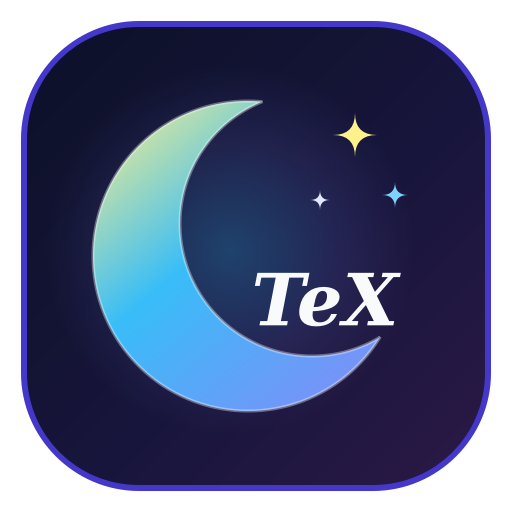

<p align="center">
  
</p>

<h1 align="center">SeleneTeX</h1>

<p align="center">
  <strong>IDE LaTeX moderno de escritorio con visor PDF + SyncTeX, herramientas visuales, previsualización de fórmulas en vivo e IA integrada.</strong>
</p>

<p align="center">
  
  
  
  
</p>

---

## Características principales

### Editor LaTeX inteligente
- **Multipestaña** con guardado individual o masivo (`Ctrl+Alt+S`), cierre con clic central y restauración automática de sesión.
- **Autocompletado contextual** de comandos, entornos, paquetes cargados, macros propias, etiquetas `\ref{}` y claves bibliográficas `\cite{}` en todo el proyecto (incluidos archivos `\input` y `.bib`).
- **Cierre automático** de delimitadores (`{}`, `[]`, `()`, `$`, `\[`, `\(`) y cierre automático de `\begin{entorno}` al pulsar `Enter`.
- **Diagnósticos en línea** con subrayado ondulado y tooltips directamente sobre las líneas con errores o avisos de compilación.
- **Búsqueda y reemplazo con Regex** (`.*`, soporte de grupos de captura `\1`, `\2`).
- **Paleta de comandos** (`Ctrl+Shift+P`), **Preferencias** (`Ctrl+,`) y temas **Oscuro / Claro** con diseño Lunar cuidado.

### Visor PDF de alto rendimiento y Compilación
- **Renderizado diferido + caché LRU + HiDPI**, búsqueda dentro del PDF (`Ctrl+Shift+F`), selección y copia de texto, salto de página, ajuste al ancho/página, vista de **doble página**, rotación 90° y **Modo Noche** (`Ctrl+Shift+D`).
- **SyncTeX bidireccional**: clic en el PDF salta a la línea de código y `Ctrl+Shift+J` salta del cursor al PDF.
- **Multi-motor**: elige entre **LuaLaTeX**, **pdfLaTeX** y **XeLaTeX**, con soporte opcional de `--shell-escape`, botón de detener compilación (`Shift+F5`), limpieza de temporales (`.tex_builds`) y exportación a PDF o `.zip`.

### Herramientas visuales y Previsualización en vivo
- **Previsualización rápida de fórmulas y diagramas TikZ** (`Ctrl+Shift+M` o automática al situar el cursor dentro de `$...$`, `\[...\]`, `equation`, `align`, `tikzpicture`).
- **Generador visual de tablas** (`Ctrl+Shift+T`) con soporte `booktabs`, pegado directo desde CSV/Excel y vista previa en tiempo real.
- **Paleta de símbolos matemáticos** (`Ctrl+Shift+Y`) con buscador instantáneo.
- **Gestor de bibliografía `.bib`** (`Ctrl+Shift+B`) con importación automática por **DOI** desde `doi.org`.
- **Plantillas listas para usar**: Artículo académico, TFG/Tesis, Presentación Beamer, Carta formal, CV y Apuntes de matemáticas.

### Selene IA integrada
- **Contexto inteligente del proyecto** (activable/desactivable con un clic): conoce tu motor activo, paquetes cargados, macros `\newcommand`, etiquetas `\label`, citas `\cite` y la ventana de código alrededor del cursor.
- **Imagen a LaTeX (OCR multimodal)**: pega una captura con `Ctrl+V`, arrastra una imagen o pulsa `Ctrl+Alt+V` para transcribir ecuaciones, tablas o diagramas.
- **Corrección inteligente de errores**: localiza automáticamente las líneas exactas del error en el log y envía solo el preámbulo + contexto relevante.
- **Visor visual de Diff** antes de reemplazar código seleccionado, inserción/copia por bloque y adición con un clic de `\usepackage{...}` faltantes.
- **Compatible con múltiples proveedores**: **Google Gemini**, **Ollama (100 % local y privado)** con detección automática de modelos instalados, **OpenAI**, **OpenRouter**, **Groq** o cualquier endpoint OpenAI-compatible, con botón de **Probar conexión**, control de temperatura, botón **Detener** y **Reintentar**.

---

## Requisitos previos

1. **Python 3.10 o superior**
2. **Distribución LaTeX local** (puedes verificar si todo está instalado desde el menú `Ayuda → Comprobar entorno LaTeX...`):
   - **Ubuntu / Debian**:
     ```bash
     sudo apt update && sudo apt install texlive-latex-extra texlive-luatex latexmk
     ```
   - **Fedora**:
     ```bash
     sudo dnf install texlive-scheme-medium latexmk
     ```
   - **Arch Linux**:
     ```bash
     sudo pacman -S texlive-basic texlive-latexextra texlive-luatex texlive-binextra
     ```
   - **macOS**:
     ```bash
     brew install --cask mactex-no-gui
     ```
   - **Windows**:
     ```powershell
     winget install MiKTeX.MiKTeX
     ```

---

## Instalación y ejecución

### Opción 1 — Descarga directa (Windows, macOS y Linux)
Descarga el ejecutable listo para usar desde la sección **[Releases](https://github.com/Repollo458/SeleneTex/releases/latest)**:

- **Windows**: descarga `SeleneTeX-windows-x86_64.exe` y ábrelo directamente.
- **macOS**: descarga y descomprime `SeleneTeX-macos-arm64.zip` y abre `SeleneTeX.app` *(si macOS avisa la primera vez por no estar firmado, haz clic derecho → Abrir)*.
- **Linux (x86_64)**: descarga `SeleneTeX-linux-x86_64` y ejecútalo:
  ```bash
  chmod +x SeleneTeX-linux-x86_64
  ./SeleneTeX-linux-x86_64
  ```

### Opción 2 — Desde el código fuente (cualquier sistema)

```bash
git clone https://github.com/Repollo458/SeleneTex.git
cd SeleneTex

# Crear entorno virtual (recomendado)
python3 -m venv .venv
source .venv/bin/activate        # En Windows: .venv\Scripts\activate

# Instalar dependencias
pip install -r requirements.txt

# Iniciar SeleneTeX
python selenetex.py
```

También puedes abrir un archivo o carpeta directamente desde la terminal:

```bash
python selenetex.py mi_documento.tex
python selenetex.py ruta/a/mi_proyecto/
```

---

## Configurar Selene IA

Abre el asistente con el botón inferior derecho o `Ctrl+Shift+A` y pulsa el icono de engranaje (`⚙`):

- **Opción 1 — Google Gemini (rápido y multimodal)**:
  1. Consigue una clave gratuita en [Google AI Studio](https://aistudio.google.com/apikey).
  2. Selecciona **Google Gemini**, pega tu clave (o define `GEMINI_API_KEY` en tu entorno) y pulsa **Probar conexión**.
- **Opción 2 — Ollama Local (100 % privado, sin API Key)**:
  1. Instala [Ollama](https://ollama.com) y descarga un modelo, por ejemplo:
     ```bash
     ollama pull qwen2.5-coder:3b
     ```
  2. Selecciona **Ollama (Local)** en SeleneTeX y pulsa **Detectar modelos**.

> **Privacidad**: tu API Key se guarda únicamente de forma local mediante `QSettings` y nunca se incluye en el repositorio ni en tus documentos `.tex`.

---

## Atajos de teclado destacados

| Atajo | Acción |
| --- | --- |
| `F5` / `Shift+F5` | Compilar documento / Detener compilación |
| `Ctrl+Shift+P` | Paleta de comandos |
| `Ctrl+Shift+A` | Abrir / cerrar Selene IA |
| `Ctrl+Alt+V` | Imagen del portapapeles a LaTeX (OCR) |
| `Ctrl+Shift+M` | Previsualizar fórmula / diagrama TikZ |
| `Ctrl+Shift+T` | Generador visual de tablas |
| `Ctrl+Shift+Y` | Paleta de símbolos matemáticos |
| `Ctrl+Shift+B` | Gestor de bibliografía (`.bib` / DOI) |
| `Ctrl+Shift+J` | Saltar al PDF desde el cursor (SyncTeX) |
| `Ctrl+F` / `Ctrl+H` | Buscar / Reemplazar (soporta Regex) |
| `Ctrl+Shift+F` | Buscar texto dentro del PDF |
| `Ctrl+Shift+D` | PDF en Modo Noche |
| `Ctrl+1` / `Ctrl+2` / `Ctrl+3` | Solo código / Vista dividida / Solo PDF |
| `Ctrl+/` | Comentar / descomentar selección |
| `Ctrl+,` | Preferencias |

---

## Generar ejecutables independientes (GitHub Releases)

Si quieres distribuir SeleneTeX sin requerir Python instalado en el equipo del usuario final:

```bash
pip install pyinstaller
python build_release.py            # Carpeta lista para comprimir en dist/SeleneTeX/
python build_release.py --onefile  # Binario único en dist/
```

---

## Licencia

Distribuido bajo licencia **MIT**. Consulta [LICENSE](LICENSE) para más información.
